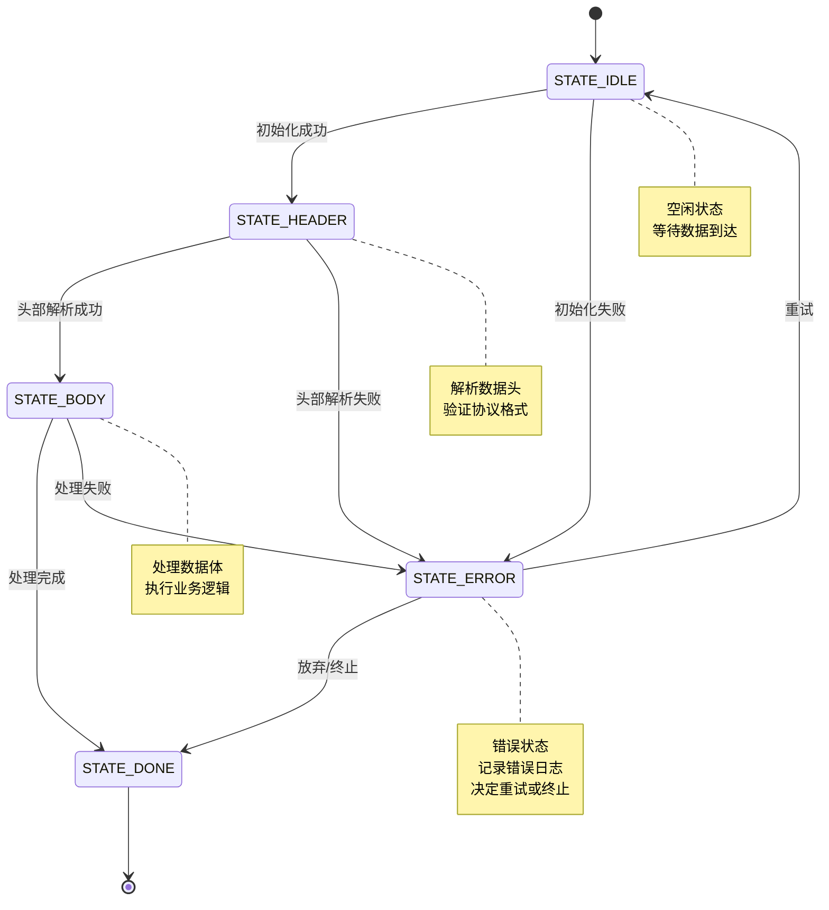
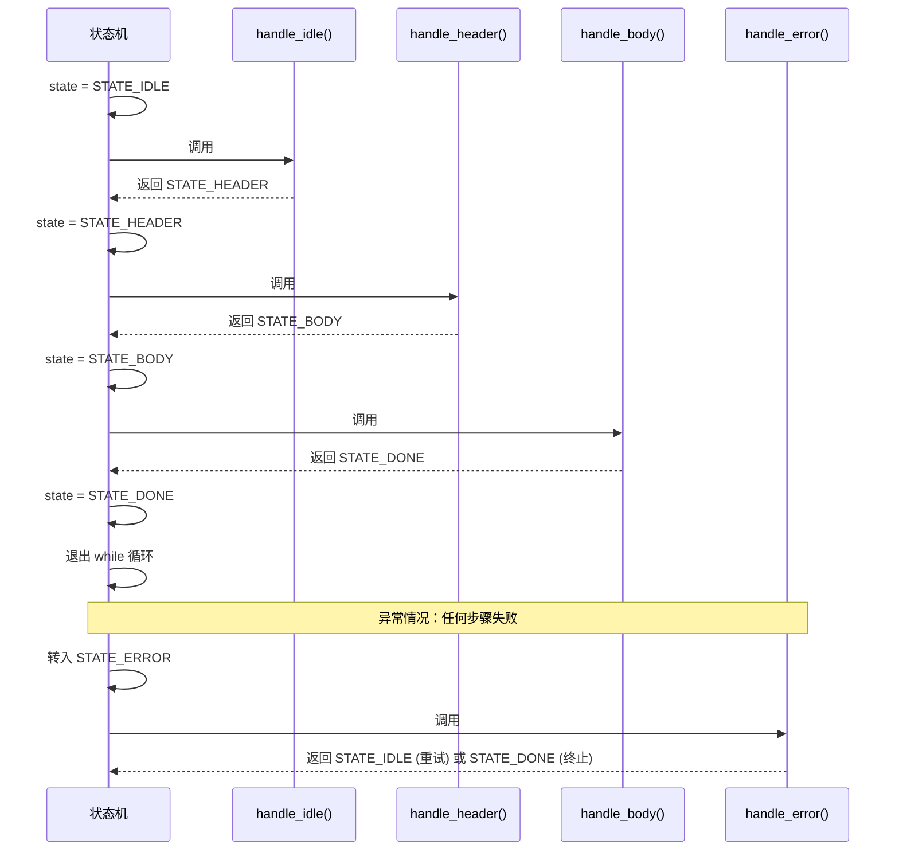

# 写了十年C，才悟出的循环与分支骚操作

---

## 引言

有些写法，课本上不教，面试不问，但老手们天天在用。

搞C语言久了，你会发现 `while`、`for`、`do-while`、`switch-case` 这几个基础语法，远比教科书上讲的要有意思得多。很多写法乍一看"离经叛道"，细品之后才发现——**原来还能这么玩？**

今天这篇文章，不讲基础语法，只聊那些在实际项目中踩坑、翻代码、跟老鸟学来的"奇技淫巧"。有些是性能优化，有些是代码简化，还有些纯粹是"炫技但确实好用"。

---

## 一、while：别只会 while(1)

### 1.1 条件里塞赋值，一行顶三行

#### 新手写法

```c
char buf[256];
fgets(buf, sizeof(buf), fp);

while (buf[0] != '\0') {
    process(buf);
    fgets(buf, sizeof(buf), fp);
}
```

#### 老手写法

```c
char buf[256];

while (fgets(buf, sizeof(buf), fp) != NULL) {
    process(buf);
}
```

**要点：**

- 把赋值操作直接放进 `while` 的条件里
- 省掉了循环外的"预读"和循环末尾的"再读"
- `fgets` 读到文件末尾时返回 `NULL`，while 条件自然终止，干净利落
- 这种写法在处理链表、读文件、读socket数据时到处都是

### 1.2 **状态流转**

**优势：**

- 把"状态流转"和"业务处理"分离开
- 加新状态就加一个 `case`
- 改流程就改返回值
- 比一堆 `if-else` 嵌套清晰太多了

**状态流转示意图：**





**执行流程示例：**

假设正常的数据接收与处理流程：





**关键要点：**

1. **单一循环**：`while(state != STATE_DONE)` 作为主循环驱动
2. **状态分离**：每个状态的处理函数独立，职责单一
3. **流转控制**：通过返回值切换到下一个状态
4. **易于扩展**：新增状态只需添加 `case` 和处理函数
5. **错误处理**：统一在 `STATE_ERROR` 处理异常情况

在嵌入式开发和协议解析中，用 `while` + 状态变量做状态机非常常见：

```c
int state = STATE_IDLE;

while (state != STATE_DONE) {
    switch (state) {
        case STATE_IDLE:    
            state = handle_idle();
            break;
            
        case STATE_HEADER:  
            state = handle_header();
            break;
            
        case STATE_BODY:    
            state = handle_body();
            break;
            
        case STATE_ERROR:   
            state = handle_error();
            break;
    }
}
```

**优势：**

- 把"状态流转"和"业务处理"分离开
- 加新状态就加一个 `case`
- 改流程就改返回值
- 比一堆 `if-else` 嵌套清晰太多了

---

## 二、for：远不止 for(i=0; i<n; i++)

### 2.1 逗号表达式——一个 for 同时跑两个变量

翻转数组的例子：

#### 普通写法

```c
for (int i = 0; i < n / 2; i++) {
    int j = n - 1 - i;
    swap(&arr[i], &arr[j]);
}
```

#### 逗号表达式写法

```c
for (int i = 0, j = n - 1; i < j; i++, j--) {
    swap(&arr[i], &arr[j]);
}
```

**执行过程：**

```
数组:  [1]  [2]  [3]  [4]  [5]
       i→                  ←j      第1轮: swap(1,5)
            i→          ←j             第2轮: swap(2,4)
                 i=j                      结束: i >= j
```

**优势：**

- `i` 从左往右走，`j` 从右往左走
- 两个指针在中间碰头就结束
- 逗号表达式让意图一目了然

### 2.2 省略三要素——for 的"残缺美"

for 的三个部分（初始化、条件、迭代）都可以省略。

#### 死循环写法

```c
for (;;) {
    // 等价于 while(1)，但有些团队更偏爱这种写法
    // Linux 内核代码里到处都是
}
```

#### 省略条件部分

```c
for (node = head; ; node = node->next) {
    if (node == NULL) break;
    
    if (node->val == target) {
        found = node;
        break;
    }
}
```

### 2.3 for 遍历链表的惯用写法

C语言没有迭代器，但 for 遍历链表可以写得很优雅：

#### 教科书写法

```c
node_t *p = head;

while (p != NULL) {
    process(p);
    p = p->next;
}
```

#### 老手写法

```c
// for 一行搞定声明、判断、移动
for (node_t *p = head; p != NULL; p = p->next) {
    process(p);
}
```

**优势：**

- `p` 的作用域被限制在 `for` 内部
- 不会污染外面的命名空间
- Linux 内核里大量使用这种模式
- 还封装了 `list_for_each_entry` 宏让它更好用

---

## 三、do-while：被低估的"保底执行"

很多人觉得 `do-while` 没啥用，用 `while` 就够了。但它在两个场景下几乎是不可替代的。

### 3.1 宏定义的"保护壳"——do { ... } while(0)

如果你翻过 Linux 内核或者任何一个成熟的C项目，一定见过这种写法：

```c
#define SAFE_FREE(ptr) do {         \
    if (ptr) {                      \
        free(ptr);                  \
        ptr = NULL;                 \
    }                               \
} while(0)
```

#### 为什么不直接用大括号？

```c
// 用大括号的宏定义
#define SAFE_FREE(ptr) { \
    if (ptr) { free(ptr); ptr=NULL; } \
}

// 在 if-else 中使用
if (condition)
    SAFE_FREE(p);  // 展开后大括号后面跟了分号
else              // ← 编译报错！else 找不到对应的 if
    do_something();
```

**问题原因：**

```c
if (condition)
    { ... };      // ← 分号变成了空语句，if 在这里结束了
else             // ← 这个 else 就"没爹"了，编译器懵了
    ...
```

而 `do { ... } while(0)` 后面加分号完全合法，完美避开这个陷阱。

**这不是炫技，是实打实的工程经验。**

### 3.2 统一出口的错误处理

在需要按步骤申请资源的函数中，`do-while(0)` + `break` 可以替代 `goto` 实现统一出口：

```c
int init_system(void)
{
    int ret = -1;

    do {
        if (init_module_a() < 0) break;
        if (init_module_b() < 0) break;
        if (init_module_c() < 0) break;
        
        ret = 0;  // 全部成功
    } while (0);

    if (ret < 0) {
        cleanup();  // 统一清理
    }

    return ret;
}
```

**优势：**

- 任何一步失败，`break` 直接跳出
- 走到统一的清理逻辑
- 代码结构平坦
- 不像嵌套 `if` 那样越写越深

---

## 四、switch-case：远比你想的能打

### 4.1 故意"穿透"——fall-through 的正经用法

`switch` 忘写 `break` 是经典 bug，但有时候故意不写才是正解：

```c
switch (log_level) {
    case LOG_FATAL:
        save_crash_dump();
        /* fall through */
        
    case LOG_ERROR:
        notify_admin();
        /* fall through */
        
    case LOG_WARN:
        write_to_file(msg);
        /* fall through */
        
    case LOG_INFO:
        print_to_console(msg);
        break;
}
```

**不同级别的处理范围：**

```
LOG_FATAL : dump + 通知 + 写文件 + 打印  (全做)
LOG_ERROR :        通知 + 写文件 + 打印
LOG_WARN  :               写文件 + 打印
LOG_INFO  :                       打印   (只打印)
```

**优势：**

- 级别越高，做的事情越多，层层叠加
- 利用 fall-through 让高级别日志自动包含低级别的处理逻辑
- 加个 `/* fall through */` 注释告诉读代码的人"这是故意的"，不是忘了写 `break`

### 4.2 Duff's Device——循环展开的神操作

这可能是C语言里最著名的"奇技淫巧"了。Tom Duff 在 1983 年发明了这个写法，用来加速数据拷贝：

```c
void duff_copy(char *to, const char *from, int count)
{
    int n = (count + 7) / 8;

    switch (count % 8) {
        case 0: do { *to++ = *from++;
        case 7:      *to++ = *from++;
        case 6:      *to++ = *from++;
        case 5:      *to++ = *from++;
        case 4:      *to++ = *from++;
        case 3:      *to++ = *from++;
        case 2:      *to++ = *from++;
        case 1:      *to++ = *from++;
                } while (--n > 0);
    }
}
```

**工作原理（假设 count = 20）：**

```
20 % 8 = 4  →  先从 case 4 开始，拷贝 4 次（处理余数）
然后进入 do-while 循环，每轮拷贝 8 次
剩余 16 / 8 = 2 轮，每轮拷贝 8 个

总计: 4 + 8 + 8 = 20 ✓
```

**核心思想：**

- switch 和 do-while 交织在一起
- 利用 fall-through 先处理不能被 8 整除的余数部分
- 然后进入循环每次批量处理 8 个
- 减少了循环判断的次数，在早期硬件上性能提升明显

**注意：**

- 现在编译器已经很智能了，自动循环展开做得比手写好
- Duff's Device 更多是作为"C语言的边界能力展示"存在
- 但理解它，你对 switch 的认知会深一个层次

### 4.3 用 switch 做跳转表

当你的 `case` 值是连续的整数时，编译器会把 `switch` 优化成跳转表（jump table），复杂度从 O(n) 降到 O(1)：

```c
// 编译器会优化成跳转表，非常快
switch (opcode) {
    case 0: return op_nop();
    case 1: return op_load();
    case 2: return op_store();
    case 3: return op_add();
    case 4: return op_sub();
    // ...
}
```

**性能对比：**

```
if-else 链:  逐个比较  O(n)
 opcode==0? → opcode==1? → opcode==2? → ...

跳转表:     直接索引  O(1)
 table[opcode] → 直接跳到对应函数
```

**适用场景：**

- 解释器、虚拟机、指令分派器
- 尽量让 case 值连续，编译器会帮你生成高效的跳转表
- 如果 case 值很稀疏（比如 1, 100, 10000），编译器就只能退化成 if-else 链了

---

## 五、技巧总结


| 语法           | 技巧            | 适用场景             | 优势            |
| ------------ | ------------- | ---------------- | ------------- |
| **while**    | 条件中赋值         | 读取文件、链表、socket数据 | 代码简洁，逻辑清晰     |
| **while**    | 状态机           | 协议解析、嵌入式开发       | 状态流转清晰，易扩展    |
| **for**      | 逗号表达式         | 双指针遍历            | 意图明显，代码优雅     |
| **for**      | 省略要素          | 死循环、特殊条件         | 灵活控制循环行为      |
| **for**      | 遍历链表          | 链表遍历             | 作用域控制，不污染命名空间 |
| **do-while** | 宏保护壳          | 多语句宏             | 避免语法错误，兼容性好   |
| **do-while** | 统一出口          | 资源申请、错误处理        | 代码平坦，易于维护     |
| **switch**   | fall-through  | 分层处理             | 代码复用，逻辑清晰     |
| **switch**   | 跳转表           | 指令分派             | 性能优化（O(1)复杂度） |
| **switch**   | Duff's Device | 循环展开             | 理解C语言边界能力     |


---

## 六、写在最后

这些写法不是为了炫技。每一个"骚操作"背后，都是某个人在真实项目里踩过坑之后总结出来的经验。

刚学C的时候，我觉得 `while`、`for` 这些东西有什么好讲的，不就是循环吗？后来写了几年项目，读了 Linux 内核代码，啃了几个开源库的源码，才发现——

**基础语法的上限远比想象的高。**

当然，骚操作也要看场合。团队项目里写 Duff's Device 大概率会被打，但理解这些技巧背后的思路，能帮你写出更简洁、更高效的代码。

**与其追求花哨的框架和新语言，不如先把手里的工具用到极致。**

---

## 参考资源

- 原文链接：[https://mp.weixin.qq.com/s/7eTatxGYF8HhSxrwTHaohA](https://mp.weixin.qq.com/s/7eTatxGYF8HhSxrwTHaohA)
- 作者：一枚嵌入式码农
- 相关推荐：
  - 嵌入式C语言设计模式实战
  - 给你的设备做一套"砖不死"的 OTA 升级方案
  - 嵌入式软件模块解耦进阶：构建高内聚、低耦合的系统架构

---

**文档结束**